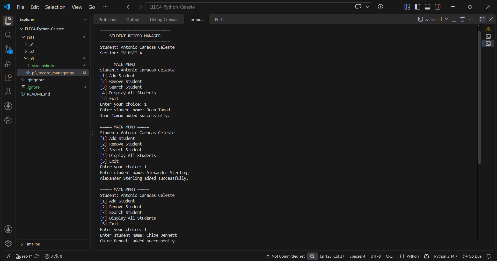
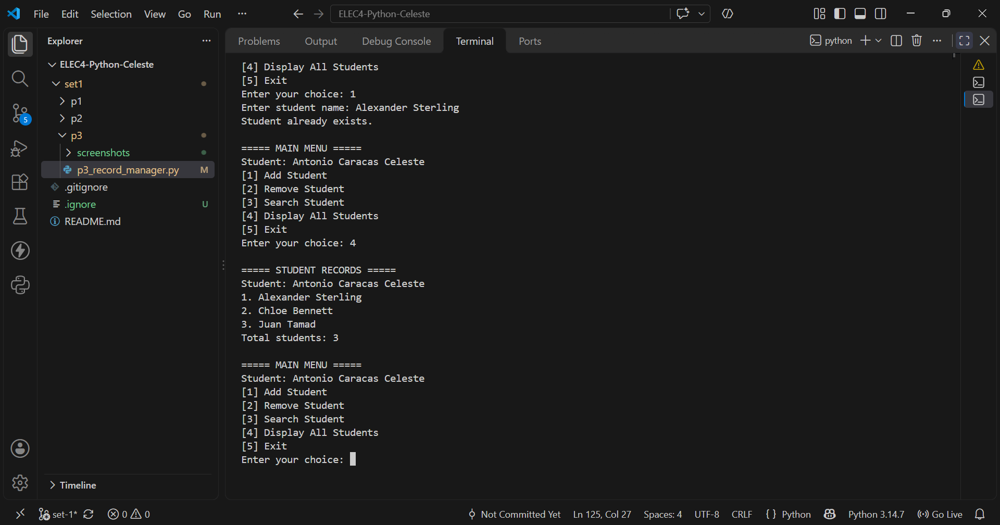
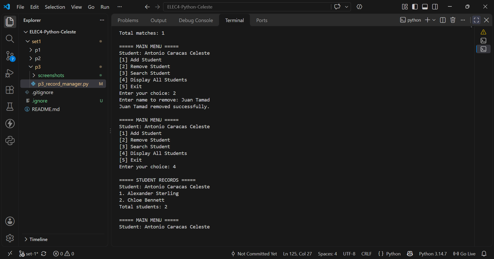

# ELEC 4 - Python Programming

**Student:** Antonio Caracas Celeste  
**Section:** IV-BSIT-A  
**Course:** ELEC 4 - Python Programming

## Set 1 Activities

| Activity | Description | Folder |
| --- | --- | --- |
| P1 | Student Grade Calculator | [View Activity](set1/p1/) |
| P2 | Custom Module: student_utils | [View Activity](set1/p2/) |
| P3 | Student Record Manager | [View Activity](set1/p3/) |

### P1 - Student Grade Calculator

A menu-driven Python program that accepts and validates
student grades, calculates the average, identifies the
highest and lowest grades, and determines the pass or
fail status.

**How to run:**

python set1/p1/p1_grade_calculator.py

**Program Output:**

### P2 - Custom Module: student_utils

A modular Python program that uses reusable functions
to calculate the average, highest and lowest grades,
and determine the pass or fail status. It demonstrates
two import styles and uses the datetime module to
display the report generation date and time.

**Source Files:**

- student_utils.py - Contains reusable grade calculation functions.
- p2_main.py - Handles user input and displays the grade report.

**How to run:**

python set1/p2/p2_main.py

**Program Output:**

**Input Validation and Failed Results:**

### P3 - Student Record Manager

A menu-driven Python program that manages student
names using lists and sets. It allows users to add,
remove, search, and display student records while
preventing duplicate entries.

**Features:**

- Add and remove student records.
- Case-insensitive duplicate prevention.
- Partial-name searching.
- Alphabetical display with numbering and total count.

***How to run:**

python set1/p3/p3_record_manager.py

**Adding Students:**

**Duplicate Prevention:**

**Display All Students:**

**Search Student:**

**Remove Student:**

